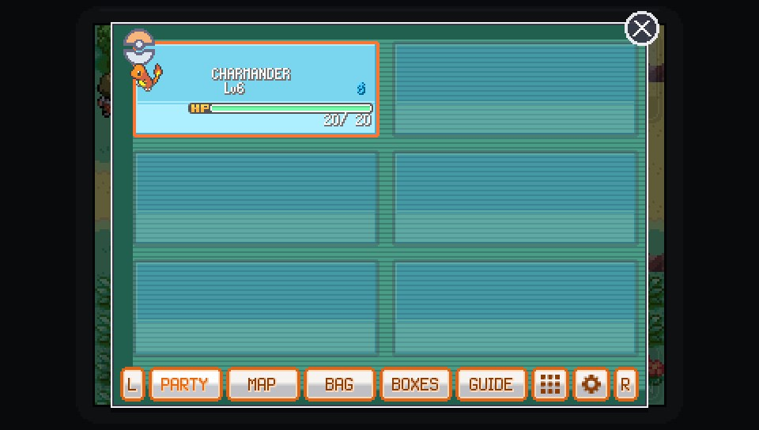
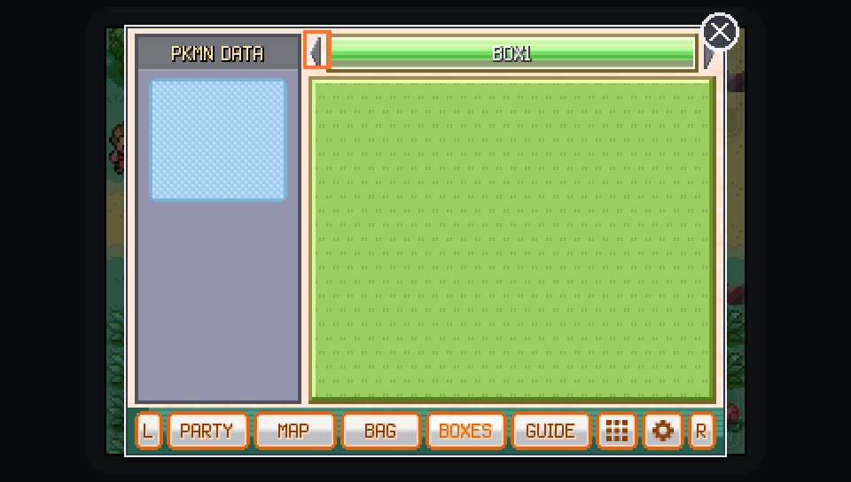
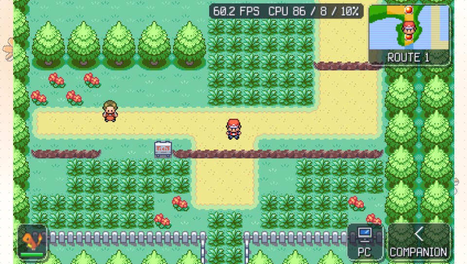

<h3>Pokémon, played better, with a live companion, a widescreen overworld, a HUD and quick menu, and every chore one button away. Now on PS VITA. This is a proof-of-concept. </h3>

  <strong><a href="#download-and-install">Download</a></strong>
  · <strong><a href="#the-companion">Features</a></strong>
  · <strong><a href="#supported-games">Supported games</a></strong>
  · <strong><a href="https://pokedaisy.com/docs/">Manual</a></strong>
  · <strong><a href="https://pokedaisy.com/feedback/#bug">Report a problem</a></strong>

PokeDaisy-PSVITA plays Game Boy, Game Boy Color and GBA games on Android handhelds, made for the Pokemon games
from Red to Black 2 and White 2 and dozens of ROM hacks. Next to the game runs a live companion that reads it as you
play: your party, bag, map, battle matchups, Pokedex and a spoiler-free guide, drawn in the game's own menu style.

## The companion

Every picture here is the real app.

<table>
  <tr>
    <td width="33%"></td>
    <td width="33%"></td>
    <td width="33%"></td>
  </tr>
  <tr>
    <td><b>PARTY</b>: your team in the game's own party screen. Tap one for stats, moves, IVs / EVs and what to learn.</td>
    <td><b>BOXES</b>: Manage your pokémons.</td>
    <td><b>MAP</b>: the region map with you on it, every place searchable, FLY and TAKE OFF.</td>
  </tr>
</table>

Also **BAG** (use and give items), **NUZLOCKE** (keeps score of a run), **CARD**, **STATES** (10 save-state slots). You pick which tabs sit on the bar.

## On the game screen

<table>
  <tr>
    <td width="50%"></td>
  </tr>
  <tr>
    <td><b>EXPAND + HUD</b>: the overworld drawn past the GBA's edges to fill a wide screen, with your party, a minimap and your bag in the corners.</td>
  </tr>
</table>

EXPAND works in every Gen 3 game, many hacks and the Game Boy's Yellow and Crystal:

## And more

- **Fast-forward** that slows down in menus, with music that keeps its tempo. Slow motion, rewind, turbo, save states,
  a shiny alert that stops it all for a shiny, and a retry for a lost trainer battle.
- **Less walking back**: PC anywhere, FLY from the map, the Pokemon Center's services on any summary, wild encounters off,
  reusable TMs, field moves without HMs, an EXP share for the whole party, a level cap at the next boss's top level,
  a keep-away spray that refills itself, no low-health beep, no poison damage while walking, auto-run, instant text.
- **Controls**: remap everything, touch controls you lay out yourself (or a Delta skin), any controller.
- **Tools**: link play (two to four games on one cable), a save editor (with what your Pokédex is missing), save trades (and trade and back for trade evolutions), Pal Park from a GBA game to a DS one, Poké Transfer on to Black and White, one collection of every save's Pokémon, BPS patching.
- **Your files**: standard `.sav` / `.srm` saves, a backup every start, zipped ROMs.

Everything is explained in the [manual](https://pokedaisy.com/docs/).

## Devices
This port is designed to run only on PSVITA. A test was done only on the OLED PS VITA.

## Download and install
[Releases](https://github.com/sshuraa/pokedaisy-psvita/releases)

**No games are included:**
use your own legally dumped ROMs.

## Supported games

Any Game Boy, Game Boy Color, GBA or DS game plays. The companion knows Red to Crystal, FireRed, LeafGreen, Emerald,
Ruby and Sapphire in every language, ROM hacks, **in the exact version listed** (another version shows a "not supported" notice). Drop your ROM into the
[ROM check](https://pokedaisy.com/#check) to see what works with it: it never leaves your browser.

NOTE: DS GAMES DO NOT WORK, WILL MAYBE BE ADDED.

Want another game supported? Ask in [Game requests](https://github.com/lidor30/pokedaisy/discussions/categories/game-requests), and upvote the ones you want.

## Privacy

The app has no accounts, ads or analytics, and your games and saves never leave your device. The website counts visits anonymously, with no cookies.

## Community and support

Come say hi, share your runs and ask questions on [r/PokeDaisy](https://www.reddit.com/r/PokeDaisy/) or
[Discord](https://discord.gg/vcmyKZZV5q). Found a bug? [Report it](https://pokedaisy.com/feedback/#bug).

PokeDaisy is free, with no ads and nothing locked. If it made a playthrough better, you can support it on
[Ko-fi](https://ko-fi.com/pokedaisy), [Patreon](https://www.patreon.com/cw/pokedaisy) or
[Buy Me a Coffee](https://buymeacoffee.com/lidor30g). It's optional, unlocks nothing and pays for PokeDaisy's own code
only: no games, ROMs or game content are sold or handed out.

## Building from source

See [docs/DEVELOPMENT.md](docs/DEVELOPMENT.md).

<strong>AI tooling note</strong>

This project may use AI-assisted development tools, such as Claude Code, to help with code generation, refactoring, and documentation. All changes are still reviewed by the maintainer and validated with the project's existing checks before release.

The PSVITA-port is HEAVILY AI-Assisted; **assisted** being the keyword.

## Credits

mGBA, rcheevos, fonts, shaders, the pret decomps, cover art sources

- [mGBA](https://mgba.io) by Vicki Pfau (endrift) and contributors runs the Game Boy, Game Boy Color and GBA games (MPL 2.0;
  source in [`third_party/mgba`](https://github.com/mgba-emu/mgba)), with its bundled blip_buf (LGPL 2.1) and inih (BSD).
- [armGBA](https://github.com/MagnominusGit/armGBA) by Magnominus runs the GBA games in the `pokedaisy_gba` libretro core (MPL 2.0;
  source in [`third_party/armgba`](https://github.com/MagnominusGit/armGBA)), with [zlib](https://zlib.net) (zlib License).
- [rcheevos](https://github.com/RetroAchievements/rcheevos) by RetroAchievements.org (MIT) for achievements.
- [Pixel Operator](https://www.dafont.com/pixel-operator.font) font by Jayvee Enaguas (CC0), and
  [Atkinson Hyperlegible](https://www.brailleinstitute.org/freefont/) by the Braille Institute (OFL 1.1) for the manual's text.
- [PixelMplus](https://github.com/itouhiro/PixelMplus) (M+ FONT LICENSE, M+ FONTS PROJECT) for Japanese text, converted to Pixel Operator's pixel grid by `scripts/gen_jp_font.py`.
- [Galmuri](https://github.com/quiple/galmuri) by Lee Minseo (OFL 1.1) for Korean text, converted to Pixel Operator's pixel grid by `scripts/gen_ko_font.py`.
- The [pret](https://github.com/pret) decompilation projects (pokered, pokeyellow, pokegold, pokecrystal, pokefirered,
  pokeemerald, pokeruby, pokeplatinum, pokeheartgold), [pokeemerald-expansion](https://github.com/rh-hideout/pokeemerald-expansion)
  and [Polished Crystal](https://github.com/Rangi42/polishedcrystal)'s, [PureRGB](https://github.com/Vortyne/pureRGB)'s, [Yellow Legacy](https://github.com/cRz-Shadows/Pokemon_Yellow_Legacy)'s and [Crystal Legacy](https://github.com/cRz-Shadows/Pokemon_Crystal_Legacy)'s source, which the game data and guides were checked against.
- Screen shaders: LCD and scanlines from mGBA's (MIT), the GBA colours by Pokefan531 and hunterk, LCD PAPER after
  RetroArch's simpletex_lcd and zfast_lcd (GPL 2.0+), and libretro's xBR, xBRZ and ScaleFX for edge smoothing
  (MIT, xBRZ GPL 3.0).
- [PokeAPI](https://pokeapi.co) (BSD 3-Clause) for the National Dex species list.
- AndroidX, Jetpack Compose, Kotlin and Apache Commons Compress (Apache 2.0), XZ for Java (0BSD).

## License

PokeDaisy is free software under the [GNU GPL v3](LICENSE), with one
[additional term](NOTICE): if you share PokeDaisy or anything built from it,
keep the credit **"Based on PokeDaisy by Lidor Itzhari -
https://github.com/lidor30/pokedaisy"** in its documentation and credits.
Forks must stay open source under the same license.

PokeDaisy is a fan project, not affiliated with or endorsed by Nintendo,
Game Freak, Creatures or The Pokemon Company. Pokemon and all related names are
trademarks of their respective owners; Game Boy, Game Boy Color and Game Boy Advance
are trademarks of Nintendo. Device names (AYN Thor, Retroid, Anbernic) belong to their
makers, and RetroAchievements and SteamGridDB are independent services; none of them
endorse PokeDaisy. ROM hacks belong to their creators. No games, BIOS or game art are
included: use your own legally dumped ROMs.
